<div align="center">

<a href="https://idlebg.com/FractalE-Sculpture_blueprint-demo.html">
  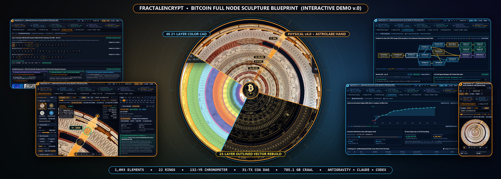
</a>

# FractalEncrypt — Bitcoin Full Node Sculpture Blueprint (`v.0` Interactive Demo)

**A self-contained `3.89 MiB` cypherpunk chronometer, `1,093`-element geometric atlas, and multi-edition forensic explorer**  
*Built in three-way AI collaboration between **Antigravity**, **Claude**, and **Codex** — orchestrated by [**idlebg.com**](https://idlebg.com/)*

[**Launch Live Viewer ↗**](https://idlebg.com/FractalE-Sculpture_blueprint-demo.html) · [**Download Single-File HTML (`3.89 MiB`)**](./FractalE-Sculpture_blueprint-demo.html)

[Explorer Hints & Ciphers](#2-interactive-field-guide-engraved-texts-hidden-values--scavenger-hints) · [Multi-AI Collaboration](#3-how-this-was-built-antigravity--claude--codex) · [Interactive Thumbnail Gallery](#5-complete-screenshot--clickable-thumbnail-index) · [`v.0` Legal Disclaimer](#7-legal-notice--v0-non-proof-disclaimer)

| `3.89 MiB` | `1,093` | `10` | `31` | `69` | `0` |
|:---:|:---:|:---:|:---:|:---:|:---:|
| single-file HTML | elements | editions | COA txs | WebP plates | network calls |

</div>

---

> [!IMPORTANT]
> **Standalone `v.0` Public Demonstration & Upcoming Full-Source Release**
> - **Live Online Preview:** [**https://idlebg.com/FractalE-Sculpture_blueprint-demo.html**](https://idlebg.com/FractalE-Sculpture_blueprint-demo.html)
> - **Fork Repository:** [**https://github.com/idlebg/Bitcoin-Full-Node-GUI-Interactive-Demo**](https://github.com/idlebg/Bitcoin-Full-Node-GUI-Interactive-Demo) *(forked from [FractalEncrypt/Bitcoin-Full-Node-GUI-Interactive-Web-Portal](https://github.com/FractalEncrypt/Bitcoin-Full-Node-GUI-Interactive-Web-Portal))*
> - **Expect Imperfections (`v.0`):** This is an **experimental standalone demo version (`v.0`)**. **Mistakes, OCR/optical transcription edge cases, geometric or projection tolerances, UI quirks, and omissions of any kind are to be expected.**
> - **Full Source Code Release:** **The complete source code** — including the editable modular viewer template, all `24` Python forensic/cryptographic/QA modules, the `3987×4096` outlined SVG vector rebuild sources, and the canonical JSON datasets — **will be released publicly when we are ready.**

---

## Contents

1. [What Is `FractalE-Sculpture_blueprint-demo.html`?](#1-what-is-fractale-sculpture_blueprint-demohtml)
2. [Interactive Field Guide: Engraved Texts, Hidden Values & Scavenger Hints](#2-interactive-field-guide-engraved-texts-hidden-values--scavenger-hints)
3. [How This Was Built: `Antigravity` × `Claude` × `Codex`](#3-how-this-was-built-antigravity--claude--codex)
4. [Visual Feature Tour](#4-visual-feature-tour)
5. [Complete Screenshot & Clickable Thumbnail Index](#5-complete-screenshot--clickable-thumbnail-index)
6. [Quick Start, Keyboard Shortcuts & Package Layout](#6-quick-start-keyboard-shortcuts--package-layout)
7. [Legal Notice & `v.0` Non-Proof Disclaimer](#7-legal-notice--v0-non-proof-disclaimer)

---

## 1. What Is `FractalE-Sculpture_blueprint-demo.html`?

In August 2020, Bitcoin artist **FractalEncrypt** ([Timechain Artifacts](https://github.com/FractalEncrypt)) created the upstream specification repository [`Bitcoin-Full-Node-GUI-Interactive-Web-Portal`](https://github.com/FractalEncrypt/Bitcoin-Full-Node-GUI-Interactive-Web-Portal) *"to house ideas related to translating the Bitcoin Full Node Sculpture blueprint to a fully functional web interface"* — envisioning:

1. **Hover Interactivity:** A magnifying loupe on hover plus live radial numerical links connecting related rings.
2. **Block Explorer Inside the Wheel:** Entering any block height updates outer-ring network stats, populates **"zoomed" side HUD containers**, counter-rotates the sculpture rings to meet at top-center (`12:00`), and deploys a **perforated "Clock Hand"** whose viewing holes frame the active year, block height, subsidy, and issuance cells.
3. **Future Timeline Projections:** Modeling future mining timestamps, hashrate, difficulty retargets, and supply across Bitcoin's 132-year Monetary Era (`2009–2140`).

**[`FractalE-Sculpture_blueprint-demo.html`](./FractalE-Sculpture_blueprint-demo.html)** realizes that 2020 web-portal blueprint inside a **single `3.89 MiB` (`4,084,087 B`) zero-dependency HTML file** that runs **100% offline over `file:///`** or any static host — while intentionally omitting live wallet/UTXO transaction-crafting and broadcast actions so the tool remains completely safe, read-only, and deterministic.

### One-Click Live Deep-Links (Open Directly in Browser)

Click any preset below to jump straight into a configured state on the live hosted build:

- [**Block `630,000` Chronometer (`Physical v4.0` + Brass Astrolabe Hand)**](https://idlebg.com/FractalE-Sculpture_blueprint-demo.html#tab=wheel&layer=R01&block=630000&theme=obsidian_gold)
- [**Inspect Element `L06.height.2020` on `Blueprint Cyan 4K` Vector Plate**](https://idlebg.com/FractalE-Sculpture_blueprint-demo.html#tab=wheel&layer=R06&el=L06.height.2020&base=vec_blueprint_4k&block=630000&theme=blueprint_cyan)
- [**Layer 14 Keplerian Astrolabe Solar Calendar (`R14`)**](https://idlebg.com/FractalE-Sculpture_blueprint-demo.html#tab=wheel&layer=R14&block=630000&theme=obsidian_gold)
- [**On-Chain COA CoinJoin Lineage DAG (`Full Node 4.0 → 10/10`)**](https://idlebg.com/FractalE-Sculpture_blueprint-demo.html#tab=coa&theme=blueprint_cyan)
- [**`480`-Bit Binary Ring Decoder, `2018` 3D Fractal QR & `3-6-9` Vortex Lab**](https://idlebg.com/FractalE-Sculpture_blueprint-demo.html#tab=forensics&theme=obsidian_gold)
- [**Live Bitcoin Knots Block Drift (`2009–2025`) & PlanB Stock-to-Flow Explorer**](https://idlebg.com/FractalE-Sculpture_blueprint-demo.html#tab=schedules&theme=blueprint_cyan)
- [**Editions `#1–#10` (`G1–G4`) Census & Side-by-Side Comparator**](https://idlebg.com/FractalE-Sculpture_blueprint-demo.html#tab=editions&theme=obsidian_gold)

### Under the Hood: How `32.77 MiB` Fits Into `3.89 MiB` (`-88.11%` / `8.41×` Smaller)

| Subsystem | Standalone Engineering Inside `FractalE-Sculpture_blueprint-demo.html` |
|---|---|
| **JSON Data Pack (`#b122-json-pack`)** | `~2.73 MB` of canonical `v4.0.0` dataset (`1,093` elements, `166` link groups, `77` diffs, `31`-tx COA dissection, schedules, `345` OCR records) compressed via **RFC 1951 raw Deflate (`level=9, wbits=-15`) + Base122 UTF-8 binary packing** (`14.29%` overhead vs Base64's `33.33%`), unpacked synchronously in `~14 ms` by an inline zero-dependency inflater. |
| **Perceptual WebP Pack (`#b122-webp-pack`)** | **`69` embedded visual plates** (alpha-preserving WebP `method=6` for cutouts + `#05070b` studio-composited ring strips & macro proofs + `4` `112×112` circular canvas thumbnails) exposed via **lazy memoizing getters** on `window.__PORTABLE_ASSETS__` so unvisited plates cost zero upfront Base64 decode time. |
| **Sub-Pixel Homography Engine** | `23` per-layer closed-form projective inverse homographies (`unprojectPhotoPoint`, round-trip error `1.11 × 10⁻¹⁶ px`) compensating for physical Z-height wood lamination parallax on `v4_photo`, paired with `+0.5 px` pixel-center stage frames on flat/vector plates and `rAF`-throttled 60fps hover. |
| **Zero External Network Calls** | `0` CDN scripts, `0` web fonts, `0` runtime `fetch()` calls, and hardened `#hash` validation so opening from USB, air-gapped desktop, or static hosting produces `0` console or network errors. |

---

## 2. Interactive Field Guide: Engraved Texts, Hidden Values & Scavenger Hints

Want to test the viewer like a puzzle box? Press <kbd>/</kbd> or <kbd>Ctrl</kbd>+<kbd>K</kbd> inside the demo (or drag the brass Astrolabe Clock Hand and Optical Loupe <kbd>L</kbd>) to hunt down these real inscriptions, mathematical anomalies, and cryptographic breadcrumbs across the sculpture:

| Field Guide | Scavenger Hint |
|---|---|
| [**A.** Outer Ring (`R01`) Ethos Plaques & `Block 630,000` Network Snapshot](#a-outer-ring-r01-ethos-plaques--block-630000-network-snapshot) | 🔎 **Hint #1** — Why did some summaries read `119 vMB` or `11.9 MB` for Mempool Size? |
| [**B.** Hidden Binary Messages (`R04`), Sacred Polyhedra & The Secret `"BTC"` Pillars (`R05`)](#b-hidden-binary-messages-r04-sacred-polyhedra--the-secret-btc-pillars-r05) | 🔎 **Hint #2** — Decode the three 8-bit binary strips hidden under the `R05` Pillar Crests! |
| [**C.** Supply Ceilings, Bit-Shift Truncation (`R03/R07/R10`), Block Drift (`R06/R09`) & Vortex Roots (`R12`)](#c-supply-ceilings-bit-shift-truncation-r03r07r10-block-drift-r06r09--vortex-roots-r12) | |
| [**D.** Quotes (`R08`), S2F (`R10`), Hal Finney `Block 170` (`R11`) & Whitepaper Glyph Dropouts (`R13`)](#d-quotes-r08-s2f-r10-hal-finney-block-170-r11--whitepaper-glyph-dropouts-r13) | 🔎 **Hint #3** — Why do Satoshi's Whitepaper equations on `R13` have commas instead of `1`s and missing Greek letters? |
| [**E.** Kepler's Astrolabe Calendar (`R14`), Reward Pyramid (`R16–R21`) & Genesis vs. `v1` Hub (`Centre`)](#e-keplers-astrolabe-calendar-r14-reward-pyramid-r16r21--genesis-vs-v1-hub-centre) | 🔎 **Hint #4** — Why does `R14`'s calendar run backwards (counter-clockwise) with December wider than July? |
| [**F.** Editions `#1–#10`, Wood Back-Plate / NFC Signatures & On-Chain COA DAG (`31` Txs)](#f-editions-110-wood-back-plate--nfc-signatures--on-chain-coa-dag-31-txs) | 🔎 **Hint #5** — On-Chain & Cryptographic Easter Eggs in the COA Graph |

> **Provenance:** `[A]` Artist Stated Intent · `[V]` Independently Verified Ground Truth · `[I]` Forensic & Optical Inference

### A. Outer Ring (`R01`) Ethos Plaques & `Block 630,000` Network Snapshot

**Search / Inspect Hint:** Select **`R01`** or search `AntPool119`, `1.19 VMB`, or `Not Your Keys`. Read clockwise from 12 o'clock along the outer hardwood rim to find all **5 cypherpunk ethos mottos**:

> `We Are All Satoshi` · `Don't Trust, Verify` · `Bitcoin Full Node` · `Cypherpunks Write Code` · `Not Your Keys, Not Your Coins`

#### Snapshot Telemetry (`v4.0` — 3rd Halving Block `630,000`, `2020/05/11 19:23:43 UTC`)

**Block Hash (`64/64` exact):** `000000000000000000024BEAD8DF69990852C202DB0E0097C1A12EA637D7E96D`

**Engraved Stats:**

- `Hash Rate: 121.09 EH/S` *(bracketed within `<0.5%` by Bitcoin Knots rolling 1,008- and 2,016-block averages `121.58` / `120.43 EH/s`)*
- `Difficulty: 16,104,807,485,529`
- `The Nonce: 2,302,182,970`
- `Transactions in Block: 3,134`
- `Size: 1,186.93 KB`
- `Weight: 3,993.25 KWU`
- `Block Reward: 7.16 BTC` *(`6.25` subsidy + `0.90968084` fees, coinbase tag `Mined by AntPool119` — mined just 20 seconds after Block `629,999`'s famous F2Pool headline `"🐟NYTimes 09/Apr/2020 With $2.3T Injection, Fed's Plan Far Exceeds 2008 Rescue"`!)*
- `Current Issuance: 18,375,000`
- `Active Addresses: 686,885`
- `USD Price: $8,657.77`
- `Software Version: 0.19.1`

<details>
<summary><b>🔎 Hint #1 — Why did some summaries read <code>119 vMB</code> or <code>11.9 MB</code> for Mempool Size? (Click to reveal)</b></summary>

- Zoom into **`L01.field.mempool_size`** (`R01`) and check the optical comparison crop in **`HD Gallery & OCR`**:
  - Physical `v4.0` (`Block 630,000`) engraves **`1.19 VMB`** in 7-segment `DS-Digital` numerals — with a tiny, razor-sharp decimal dot tucked tightly between `1` and `19` (`v4_4_4604x3031.jpg`, `EtjAgf4XAAAp_fd`, and `Exq2unjWgAIow9X`).
  - Meanwhile, **Edition `#1 of 10`** (`Block 600,000`, `2019/10/19 01:04 UTC`) genuinely engraved **`MEMPOOL SIZE: 11.9 MB`**, **`AVG. BLOCK TIME: 825 SECONDS`** (seconds instead of minutes!), and **`UNMINED BITCOINS: 3,000,000`** (before that slot was renamed `BLOCK REWARD` on `v4.0`!). Mixing up `#1` and `#4` caused third-party AI summaries to hallucinate `11.9 MB` onto `v4.0`.
</details>

---

### B. Hidden Binary Messages (`R04`), Sacred Polyhedra & The Secret `"BTC"` Pillars (`R05`)

#### Layer 4 (`R04`) `480`-Bit Plain-ASCII Ring

Open the **`Binary · 3-6-9 · QR`** tab and click any of the **`60` bytes (`480` bits)** — or click **Highlight Arc on Wheel →** to light up each binary sector directly on the sculpture! No cipher or XOR is used; plain 8-bit ASCII (`471/480 = 98.12%` blind unsupervised 2D NCC glyph match, `9/9` optical confirmation) spells three messages separated by the 3 Pillar Crests:

| Arc | Bytes | Clock | Message | Binary |
|:---:|:---:|:---:|---|---|
| **Arc A** | `19 B` | 1–3 o'clock | `"stock to flow ratio"` | `01110011 01110100 ...` |
| **Arc B** | `23 B` | 4:30–7:30 | `"Craig Wright is a Fraud"` | `01000011 01110010 ...` |
| **Arc C** | `18 B` | 9–11 o'clock | `"Bitcoin Fixes This"` | `01000010 01101001 ...` |

> *Spreadsheet Easter Egg:* FractalEncrypt's working Excel table (`a14`) also drafted `"Everything divided by 21 million"` *(later engraved on Edition `#9`!)*, `"ONE CPU ONE VOTE"`, `"Have Fun Staying Poor"`, and **`"bitcoin boating club"`** *(resolving a livestream auto-caption mis-hearing of `"bitcoin voting club"`)*. Edition `#2`'s binary arc ends in `01101111 01101001 01101110 01110011` (`"...oins"` — matching `"Not Your Keys, Not Your Coins"` `[I]`).

#### Layer 5 (`R05`) Mycelial Merkle Ring (`21` Trees + `18` Polyhedra + `3` Crests)

Count **`21` mycelial Merkle trees** (`3 × 7`, symbolizing `21M` & *"The Mycelium of Money"* — **zoom into the upper branches of any tree to spot a miniature hidden `₿` glyph!**) linked by **`18` geometric "blocks"** comprising the **complete mathematical set of all `5` Platonic solids** *(Tetrahedron, Cube, Octahedron, Icosahedron, Dodecahedron)* **plus all `13` Archimedean solids** (`5 + 13 = 18`, plus `3` Pillar Crests = `21`).

<details>
<summary><b>🔎 Hint #2 — Decode the three 8-bit binary strips hidden under the <code>R05</code> Pillar Crests! (Click to reveal)</b></summary>

Inspect **`R05`** at **12 o'clock (`SOCIAL` / `COMMUNITY`)**, **4 o'clock (`TECHNICAL` / `Y^2 = X^3 + 7` — the `secp256k1` elliptic curve!)**, and **8 o'clock (`FINANCIAL` / `GOLD 2.0`)**. Along the lower border of each crest sits a single 8-bit byte between `LOADING....` rails:

| Pillar Crest | Clock | 8-Bit Byte | Hex | ASCII |
|---|:---:|:---:|:---:|:---:|
| `SOCIAL` | `12:00` | `01000010` | `0x42` | **`B`** |
| `TECHNICAL` | `4:00` | `01010100` | `0x54` | **`T`** |
| `FINANCIAL` | `8:00` | `01000011` | `0x43` | **`C`** |

Together across the 120° triad, the three crests spell **`"BTC"`**!

</details>

---

### C. Supply Ceilings, Bit-Shift Truncation (`R03/R07/R10`), Block Drift (`R06/R09`) & Vortex Roots (`R12`)

#### The `20,999,999.9769 BTC` Ceiling vs. `21,000,000.0` Smoothing

- At `12:00` on **`R03`**, the **Halving Crest** engraves Bitcoin Core's integer-floor summation:

  $$\sum_{i=0}^{32} 210000 \frac{\lfloor (50 \cdot 10^8) / 2^i \rfloor}{10^8} = \mathbf{20{,}999{,}999.97690000\text{ BTC}} \quad (2{,}099{,}999{,}997{,}690{,}000\text{ sats})$$

- On **`R07`**, all **34 block-subsidy boxes** (`50.00000000` down to `0.00000001` at Era 32, and `0.00000000` at Era 33) match C++ integer right-shift `(50 * 10^8) >> i` (`GetBlockSubsidy`) **34/34**, capturing the first odd-satoshi truncation at **Era 10 (`0.04882812 BTC` = `4,882,812` sats instead of `.125`)**!
- Yet if you follow **`R10`** (*Total Issuance*) to sections `28–34`, the sculpture steps symbolically by `.91, .93, .95, .97, .98, .99, 21000000.0` (`+0.0231 BTC` above the exact integer cap!).

#### Physical Cutout Halving Angles (`R03`)

`16` open-alpha walnut cutouts + `18` thin laser-kerf slits (`34` total). Era 0 spans **`119.50°`** (~1/3 of the circle) and halves cleanly clockwise:

> `119.50° → 63.50° → 30.90° → 15.30° → 7.70° → 4.10° → 2.20°`

#### Two Different "Blocks Per Year" Clocks (`R06` vs. `R09`) & Live Chain Drift

- **`R06`** (*Block Height by Year*, `2009–2140`) steps by **`52,500` blocks/year** (`210,000 / 4`, ending at Block **`6,930,000`** in `2140`, spanning `floor(6,930,000 / 2,016) = 3,437` difficulty retargets on **`R12`**).
- **`R09`** (*BTC Per Day / Year*) multiplies `144` blocks/day × `365` days = **`52,560` blocks/year** (`7,200.00000/day` & `2,628,000.00000/yr` in Era 0; `900.00000/day` & `328,500.00000/yr` in Era 3; `3.51562464/day` at Era 11).

Open **`Schedules & S2F`** to see how actual mainnet mining drifted against `R06`'s `52,500/yr` grid:

| Year | Actual Mainnet Mining | Drift Against `R06`'s `52,500/yr` Grid |
|:---:|---|---|
| **`2009`** | ended at Block `32,489` | `-20,011` behind due to slow early CPU mining |
| **`2020`** | hit `663,912` | `+33,912` ahead — Block `630,000` arrived May 11 rather than Dec 31! |
| **`2025`** | reached **`930,340`** | **`+37,840` blocks ahead**! |

#### Pure-K Hidden Years & Level39 `3-6-9` Digital Roots (`R12`)

Separating the CMYK `Pure-K` (`C0 M0 Y0 K98`) plate revealed **`34` microscopic mid-era years (`2010, 2014, 2018, ..., 2142`)** on `R12`, while `R12`'s `17` odd-halving labels (`210,000`, `630,000`, `1,050,000`, ..., `6,930,000`) reduce modulo 9 to the exact alternating **`3, 9, 6`** `inner17` vortex sequence!

---

### D. Quotes (`R08`), S2F (`R10`), Hal Finney `Block 170` (`R11`) & Whitepaper Glyph Dropouts (`R13`)

#### Layer 8 (`R08`) Three Inscribed Arcs

- `SOVEREIGNTY THROUGH MATHEMATICS` *(upper-left)*
- `BITCOIN: THE PEACEFUL REVOLUTION` *(upper-right — **replaced with `THE BITCOIN STANDARD` on Edition `#7` MirrorNode `[V]/[A]` and reported on `#5` Saylor!**)*
- `// THE TIMES 03/JAN/2009 CHANCELLOR ON BRINK OF SECOND BAILOUT FOR BANKS //` *(bottom arc)*

#### PlanB Stock-to-Flow Equations (`R08/R10` Border)

- `MODEL PRICE (USD) = EXP(-1.84) * SF ^ 3.36`
- Symmetric twin `EXP(-1.84) * SF ^ 3.36 = X USD`
- Bottom `LN(MARKET VALUE) = 3.3 * LN(SF) + 14.6` *(at Block `630,000`, `SF = 55.94` → `$1.283T` market cap / `~$69,800` vs `$118,343` curve)*.

#### First Person-to-Person Bitcoin TX (`R11`)

Block `170`, `1/11/2009` US time / `2009-01-12 03:30:25 UTC`, TX `f4184fc5...`

- Top clasp reads `50 BTC --> (SCANNING.... ₿ ....MEMPOOL) -->` *(whereas pre-final blueprint print `tw13` caught an early typo: `SCANNING.... ₿ ....SCANNING`!)*.
- `RECEIVE ADDRESS: 1Q2TWHE3GMDB6BZKAFQWXXTWAWGFT5JVM3: 10 BTC` (Hal Finney)
- `SEND / CHANGE: 12CBQLTFMXRNSZKTFKUOG3EHOMEFTPTU3S: 40 BTC` (Satoshi — rendered in all-uppercase font, dropping Base58 case sensitivity).

<details>
<summary><b>🔎 Hint #3 — Why do Satoshi's Whitepaper equations on <code>R13</code> have commas instead of <code>1</code>s and missing Greek letters? (Click to reveal)</b></summary>

- Select **`R13`** and zoom in with the Loupe (<kbd>L</kbd>): the ring tiles **5 equation blocks × 2** (exact 180° rotational symmetry) from Section 11 of Satoshi's whitepaper ($\lambda = z \frac{q}{p}$ and Poisson attacker catch-up probability $1 - \sum_{k=0}^{z} \frac{\lambda^k e^{-\lambda}}{k!}(1 - (q/p)^{z-k})$).
- When the TeX/PDF equations were imported into Adobe Illustrator, a **Symbol/math font encoding dropout** stripped Greek **$\lambda$**, Euler's **$e$**, turned numeral **`1` into `,`**, and turned `k=0` into `k=>` — an artifact frozen permanently across physical `v4.0`, MirrorNode `#7`, and the 2022 `84"×40"` Blueprint Canvas! Also notice `R13` sits rotated by **`-8.252°`** on physical `v4.0` (hand-assembly glue-up tolerance of an unkeyed wooden ring).
</details>

---

### E. Kepler's Astrolabe Calendar (`R14`), Reward Pyramid (`R16–R21`) & Genesis vs. `v1` Hub (`Centre`)

<details>
<summary><b>🔎 Hint #4 — Why does <code>R14</code>'s calendar run backwards (counter-clockwise) with December wider than July? (Click to reveal)</b></summary>

Inspect **`R14`** (*Perpetual Calendar*): unlike `R02–R12` (clockwise), the 12 months run **counter-clockwise** with:

| Clock | Month | Solstice / Equinox |
|:---:|:---:|---|
| `12:00` | `June` | Summer Solstice, Jun 21 |
| `3:00` | `March` | Vernal Equinox |
| `6:00` | `December` | Winter Solstice, Dec 21 |
| `9:00` | `September` | Autumnal Equinox |

- Although both December and July have **31 days**, December spans **`31.78°` (`1.025°/day`)** while July spans only **`29.60°` (`0.955°/day`)** — a `2.18°` difference!
- Fitting a 1st harmonic across `351` measured Pure-K day intervals recovers **Earth's orbital eccentricity `e = 0.0174`** (true astronomical value **`e = 0.01671`**), peaking at **Perihelion (Jan 3–4)** and slowing at **Aphelion (Jul 5)** with all 12 month dividers pointing radially within `2.6 px` of the wheel center.
- Layer 14 is a genuine **concentric planispheric astrolabe solar calendar implementing Kepler's Second Law**!

</details>

#### Core Pyramid (`R15–R21`) & Wood-Grain Detective Work

- **`R15`** crowns the core with `10 Minute Block Time` and `1..10` Poisson confirmation rays; below it, **`R18`** (`Double Digit`: `50`, `25`, `12.5`), **`R19`** (`Single Digit`: `6.25`, `3.125`, **`1.562`** — truncated at 3 decimals from `1.5625`!), and **`R16–R17`** (`28 Sub-bitcoin Eras`) total `3 + 3 + 28 = 34` eras, framed by curved rulers **`0..21` (`R20`)** and **`0..34` (`R21`)**.
- *Physical Core Anomaly (`Q25`):* Scarce City gallery photo `8abc4134` (`v4_2`) has **90°-rotated horizontal walnut grain**, **6 blank maple reward cells**, and a ~30° `R13` rotation shift compared to `v4_original` — proving it photographed a different/earlier physical core assembly!

#### Central Medallion (`Centre` — `v4.0` Genesis vs. `v1` / Draft `1F32vsFv...`)

- **Final `v4.0` Hub:**
  - Hardcoded Block 0 hash `000000000019D6689C085AE165831E934FF763AE46A2A6C172B3F1B60A8CE26F`
  - Internal little-endian Merkle root `3BA3EDFD7A7B12B27AC72C3E67768F617FC81BC3888A51323A9FB8AA4B1E5E4A`
  - Byte-reversed `scriptPubKey` pubkey prefix `0x5F1DF16B2B704C8A578D0B`
  - Small-caps Base58-preserving **`1A1zP1eP5QGefi2DMPTfTL5SLmv7DivfNa`**
- **Transitional `v4.0` Draft (`Eti_4ItXAAQTSjx`, uploaded `38 ms` after the wheel with `21,076` blue laser-cut pixels!) & `v1` / Blueprint Hub:**
  - Pairs `secp256k1` generator point `G` (`0479BE667E...`)
  - with 32-bit binary `01010010101110101001001010100101` (`0x52BA92A5` = `1387958949`, or `2013-12-25 08:09:09 UTC` as Unix time)
  - and checksum-verified P2PKH **`1F32vsFv5a9PH2zZtTQFamV9wB1GDAqSBw`** (`0` transactions & `0` hits across `785.083 GB` of mainnet block files!).

---

### F. Editions `#1–#10`, Wood Back-Plate / NFC Signatures & On-Chain COA DAG (`31` Txs)

Open **`Editions #1–#10`** and **`COA DAG & Crypto`** to explore the full 10-sculpture lineage (`G1–G4`) and downstream artworks:

| Edition | Gen | Verified Snapshot Block | Notable Features, Collector & On-Chain COA Anchor |
|---:|:---:|---|---|
| **`#1`** | `G1` | **`600,000`** `[V]` | Miami Jan 2020 reveal; `UNMINED BITCOINS: 3,000,000`, `825 SECONDS`, `11.9 MB`, `0.18.1`; no on-chain COA. |
| **`#2`** | `G1` | **`613,709`** `[V]` | Hash `...15961435c42d0e08...` (`2020-01-20`); Layer 4 ends `...oins`; Oct 2025 re-auth added mirrored `₿` & `i=0..32` Crest. |
| **`#3`** | `G1` | *Open* | Final `G1` perfect-circles wood build (`"dramatic changes"` vs `#1/#2`); sold privately pre-Feb 2021. |
| **`#4`** (`v4.0`) | `G2` | **`630,000`** `[V]` | *"The Halving"* reference master; NFC tag + signed wood back-plate; won by `Jeff` (`@SatoshisArk`, `1.72 BTC`); initiates COA DAG at **`32dab765...`** (`Blk 665,216`, signer `1KZ8q6HKdTc1DsENqu722sDkrALGpdFXLi`). |
| **`#5`** (`v5.0`) | `G2` | **`632,772`** `[V]` | **Michael Saylor** commission (`280.59 GB`, `9.58 MIN`); COA **`f67c662c...`** (`Blk 671,575`, `1Zk3tu...`). |
| **`#6`** (`v6.0`) | `G2` | *Open* | **Eric Weiss** collection; minted Pi Day `3/14/2021`; COA **`8ecb47d0...`** (`Blk 674,542`, `1ANsxm...`). |
| **`#7`** (`v7.0`) | `G3` | **`630,000`** `[V]` | *"MirrorNode"* (all-mirror + Musou black); swaps R8 quote to **`THE BITCOIN STANDARD`**; won by `MimesisCapital` (`15.1 BTC`); COA **`e4161913...`** (`Blk 684,902`, `169wHj...`). |
| **`#8`** (`v8.0`) | `G3` | **`686,604`** `[V]` | Silver/gold/blue mirror (`@protagonist4now`); snapshot block coinbase `cb01ea70...` embeds **`Diario El Salvador 6/Jun/2021 Bitcoin tendra validez legal`**; COA **`03339a06...`** (`Blk 691,470`, `18X5j2...`). |
| **`#9`** (`v9.0`) | `G4` | *Bracketed `~687.5k–697.8k`* | Black holographic rainbow acrylic (`$48,8xx`, `350.57 GB`, `9.51 MIN`); R4 `"Everything divided by 21 million"`; COA **`f351c7fe...`** (`Blk 710,751`, `1L2Yys...`). |
| **`#10`** (`10/10`) | `G4` | *Open (`<= Jun 2022`)* | **Ricardo Salinas Pliego** terminal commission (`"...10/10 created for Ricardo Salinas Pliego by FE"`); COA **`32450eee...`** (`Blk 741,700`, `16fRMm...`). |

<details>
<summary><b>🔎 Hint #5 — On-Chain & Cryptographic Easter Eggs in the COA Graph (Click to reveal)</b></summary>

- **Wood Back-Plate & NFC Signature Solved (`verifymessage = TRUE`):**
  - On piece `4 of 10`, the `Nasalization` font engraves lowercase `a,c,d,f,g,h,i,j,k,p,s,x,y,z` as **x-height small capitals** and puts a diagonal slash through every digit `0`.
  - Calibrating against iPhone NFC video frames (`H1oc5HKixBg`) decoded `H7DmZ4DnOympj6Wg9+CnPtMckd/mA57d4y6NBX5SK73cD/ffxzaecO392vnU7axTXSSeihYzs4zsFmjkFya1LKg=`, which verifies `TRUE` for `1KZ8q6HKdTc1DsENqu722sDkrALGpdFXLi` and recovers compressed pubkey `02d1787e...` matching `coa_v4 vin[3]` byte-for-byte!
  - Even the `158/158` engraved hex characters preserve the exact **double space** before `by FractalEncrypt.`.
- **Taproot Vanity Art & Intentional `88,888`-Sat Fee:**
  - Downstream of `v5/v6/v9`, TX `71c2955b...` & `b80ca1dc...` fund Taproot vanity addresses:
    - **`bc1pfractaltyrtxx...`** (`212,121` sats)
    - **`bc1pencrypt3ufuc9...`** (`28,922` sats)
    - **`bc1pkeysx20m563f...`** (`80,000` sats)
  - which spend together into `cb9fa328...` (*Infinity Day Public Keys*) with an intentional **`88,888`-sat fee** to mint **`210` sequential Taproot vanity outputs (`bc1pkey1..bc1pkey210`, `1,001..1,210` sats — all `210/210` still unspent!)**.
- **Raw `0x221E` Infinity Bytes & `2018` 3D Fractal QR:**
  - Commission TX `5da0c5f9...` (*Alexandra & Marco*) ends `746,437 to ` + raw 2-byte big-endian **`22 1E`** (`U+221E` = `∞`, rather than 3-byte UTF-8 `E2 88 9E`!)
  - *Endless Chain* `4/9` (`c6b38f65...`, Block `840,000`) rests on unspent `4,444` sats
  - FractalEncrypt's **2018 3D Fractal QR** (`tw08_Eu3JQCqWYAoLvkb`, Version `6-H`, `0` RS errors) decodes to **`bitcoin:35G2bt4kzUXpDHKNe9D7GjNYUoBn7VPF9v`** holding **`323,599` live unspent sats** since Block `525,788` (`2018-06-03`)!

</details>

#### 4 Genuinely Open Mysteries

1. Exact snapshot blocks of `#3, #6, #9, #10` (plus a `25-BTC`-era `$198` Miami 2022 exhibition wood piece, closest Knots candidate Block `265,138`)
2. Physical back-plate signatures of `#5–#10`
3. Macro photos of `#4` Pillar Crests
4. The artist's original `52,500` vs `52,560` spreadsheet

---

## 3. How This Was Built: `Antigravity` × `Claude` × `Codex`

This standalone demo and the research behind it are the outcome of a **three-way AI collaboration** directed by [**idlebg.com**](https://idlebg.com/), bringing together **Antigravity** (Google DeepMind), **Claude / Claude Code** (Anthropic), and **Codex** (OpenAI):

### Skeptical Cross-Auditing Over Single-Model Trust

Whenever one agent proposed an optical reading, geometric fit, or historical attribution, another agent independently tested it against raw pixel crops, ISO/IEC 10918-1 progressive JPEG DCT coefficient matrices, or local **Bitcoin Knots (`txindex=1`) + Fulcrum Electrum** RPC queries. Mutual cross-checks caught subtle traps — separating `M = Y` chroma subsampling bleed from genuine cyan-blue Illustrator laser-cut layers (`21,076` cut pixels), catching a stale `a26` Genesis-hex figure pointer, confirming the crisp `1.19 VMB` decimal dot on `v4.0`, and quarantining hallucinated third-party summaries.

### Strict `[A]` / `[V]` / `[I]` Provenance Architecture

Every ring and element inspector card separates:

- **`[A]` Artist Stated Intent** (threads, livestreams, CAD legends)
- **`[V]` Independently Verified Ground Truth** (pixel crops, `57/57` ECDSA + `5/5` BIP340 Schnorr math, `5,879` `blk*.dat` / `785.083 GB` full-chain sweep `0 → 977,082`)
- **`[I]` Forensic & Optical Inference**

### Precision Cartography, Vector Rebuilds & Studio Polish

Combining the `1,093`-element coordinate map (`842` wheel + `251` `OV` elements, `166` cross-ring link groups, `77` design-state differences, and `23` projective `v4_photo` homographies), `3987×4096` outlined vector rebuilds (`130` `.not-in-line-art` core texts), responsive studio UI design, adversarial URL/hotkey hardening, 4-viewport Chromium Playwright QA, and custom Deflate-9/Base122/WebP single-file compilation yielded [`FractalE-Sculpture_blueprint-demo.html`](./FractalE-Sculpture_blueprint-demo.html).

---

## 4. Visual Feature Tour

*(Click any preview image below to view the full-resolution capture.)*

<table>
  <tr>
    <td width="50%" align="center">
      <a href="screenshots/01_wheel_1440x900.jpg">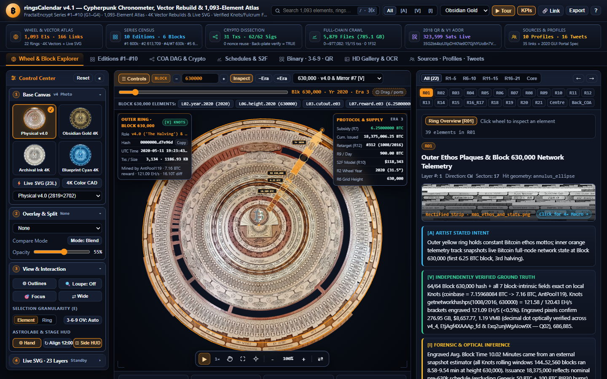</a>
      <br/><sub><b>Main Chronometer Studio (<code>Obsidian Gold</code>)</b> — Physical <code>v4.0</code> sculpture, 8-port brass Astrolabe Hand, Side HUDs, Control Center &amp; <code>[A]/[V]/[I]</code> Inspector.</sub>
    </td>
    <td width="50%" align="center">
      <a href="screenshots/02_element_inspector_1440x900.jpg">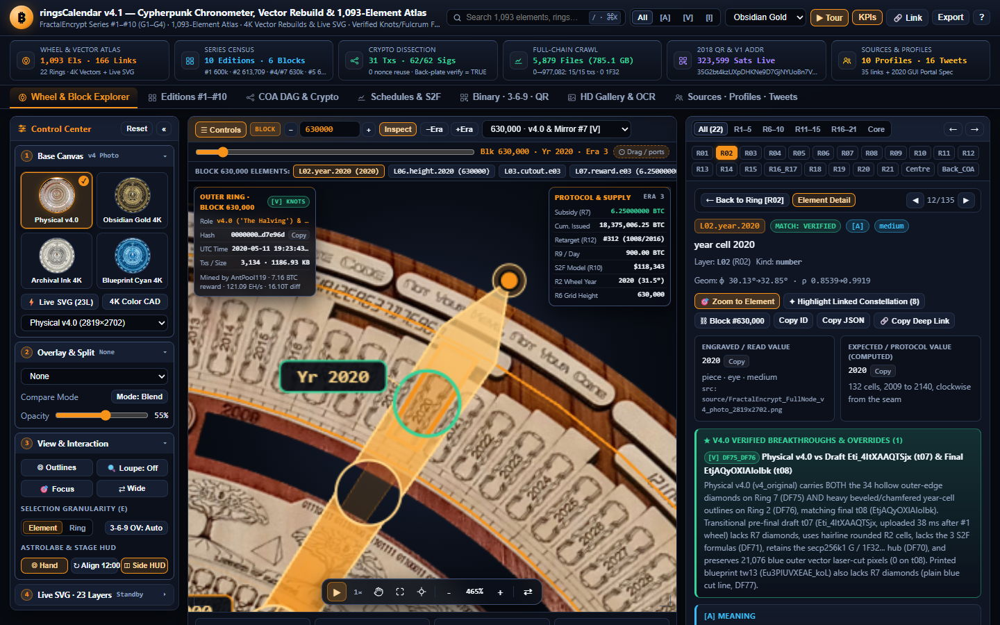</a>
      <br/><sub><b>Per-Element Homography Zoom (<code>465%</code>)</b> — Inspecting <code>L02.year.2020</code> with clockwise neighbor steppers (<code>◀/▶</code>), linked constellation trigger &amp; <code>DF75/DF76</code> overrides.</sub>
    </td>
  </tr>
  <tr>
    <td width="50%" align="center">
      <a href="screenshots/12_livesvg_split_overlay_1440x900.jpg">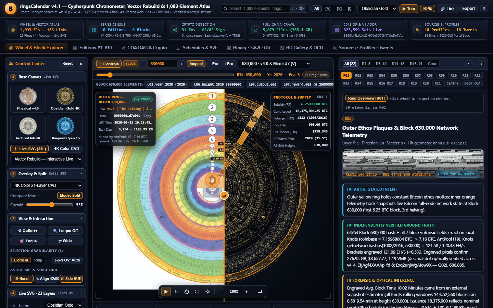</a>
      <br/><sub><b>Draggable Split-Curtain Wipe</b> — Real-time registration comparing <code>4K 21-Layer Color CAD</code> (left) against the <code>Obsidian Gold Vector Rebuild</code> (right).</sub>
    </td>
    <td width="50%" align="center">
      <a href="screenshots/13_split_align12_1440x900.jpg">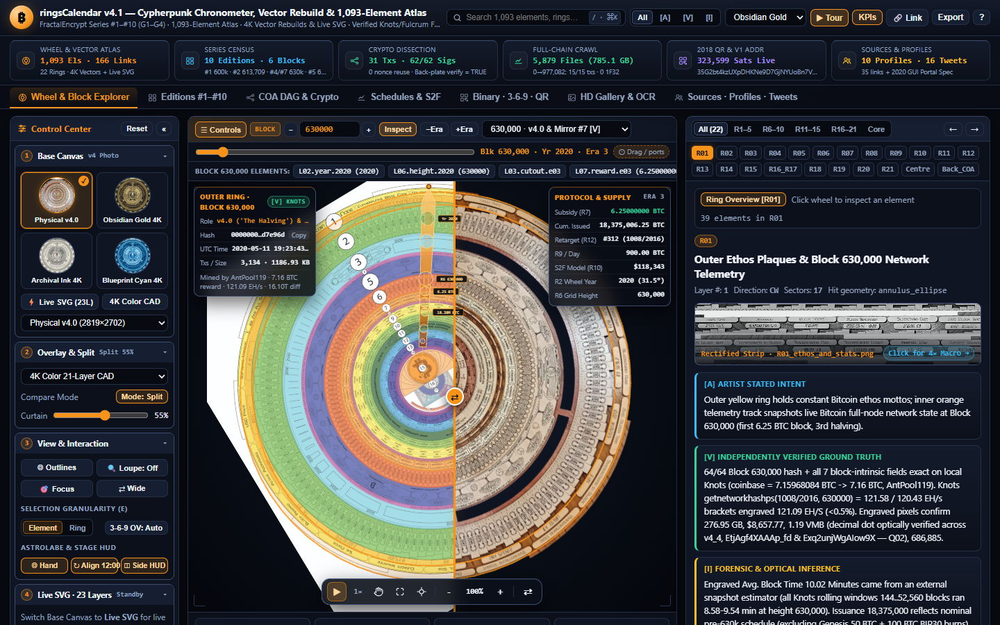</a>
      <br/><sub><b><code>Align 12:00</code> + Locked Vertical Curtain</b> — Rotates the active sculpture year straight to top-center while keeping the comparison curtain vertical.</sub>
    </td>
  </tr>
  <tr>
    <td width="50%" align="center">
      <a href="screenshots/14_coa_blueprint_1440x900.jpg">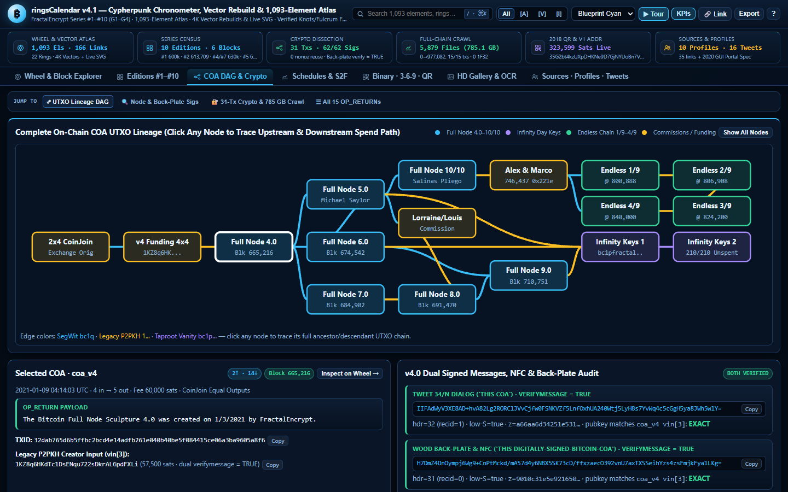</a>
      <br/><sub><b><code>COA DAG &amp; Crypto</code> (<code>Blueprint Cyan</code>)</b> — Interactive BFS ancestry across <code>Full Node 4.0–10/10</code>, <i>Infinity Keys</i> &amp; dual <code>verifymessage = TRUE</code> proofs.</sub>
    </td>
    <td width="50%" align="center">
      <a href="screenshots/04_forensics_1440x900.jpg">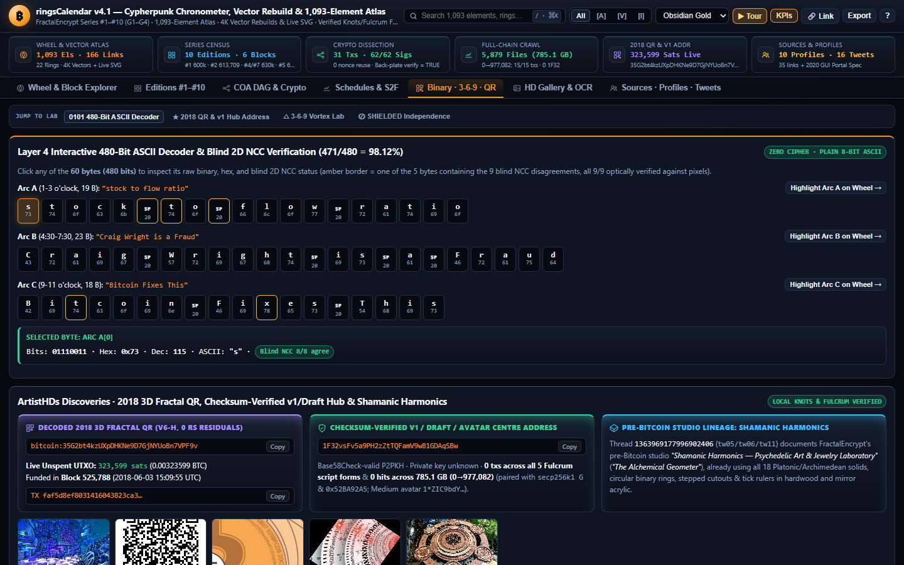</a>
      <br/><sub><b><code>Binary · 3-6-9 · QR</code> Forensics Lab</b> — Interactive 60-byte Layer 4 ASCII decoder, wheel arc highlighter, <code>2018</code> 3D QR (<code>323,599</code> sats) &amp; <code>1F32vsFv...</code> hub audit.</sub>
    </td>
  </tr>
</table>

---

## 5. Complete Screenshot & Clickable Thumbnail Index

Every capture in [`screenshots/`](./screenshots) is compressed to progressive JPEG for fast loading and rendered below as a **clickable thumbnail** — click any thumbnail or filename to inspect the full-size image, then try the paired prompt inside the demo:

| Preview Thumbnail *(click to enlarge)* | File & Viewport / Mode | What It Shows & Interactive Hint to Try |
| :---: | :--- | :--- |
| <a href="screenshots/00_hero_banner.jpg"></a> | [`00_hero_banner.jpg`](screenshots/00_hero_banner.jpg)<br/>`1680×600` · **Composite Banner** | Tri-split central medallion (`4K Color CAD` · `Physical v4.0 + Hand` · `23-Layer Vector Rebuild`) flanked by studio cards. |
| <a href="screenshots/01_wheel_1440x900.jpg"></a> | [`01_wheel_1440x900.jpg`](screenshots/01_wheel_1440x900.jpg)<br/>`1440×900` · `Obsidian Gold` | Default 3-column desktop workspace at `Block 630,000`. *Hint: press <kbd>Space</kbd> to animate the 132-year chronometer!* |
| <a href="screenshots/02_element_inspector_1440x900.jpg"></a> | [`02_element_inspector_1440x900.jpg`](screenshots/02_element_inspector_1440x900.jpg)<br/>`1440×900` · `465%` Zoom | Element Detail Inspector on `L02.year.2020`. *Hint: press <kbd>C</kbd> to fire 8 radial Linked Constellation rays across rings!* |
| <a href="screenshots/03_live_svg_1440x900.jpg">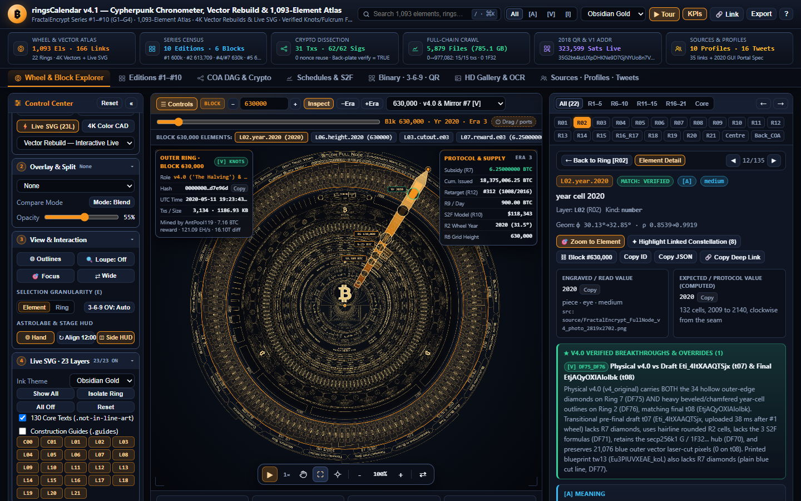</a> | [`03_live_svg_1440x900.jpg`](screenshots/03_live_svg_1440x900.jpg)<br/>`1440×900` · `Live SVG / Vector` | Outlined `3987×4096` vector reconstruction (`23` layers + `130` `.not-in-line-art` core texts) in Obsidian Gold ink. |
| <a href="screenshots/04_forensics_1440x900.jpg"></a> | [`04_forensics_1440x900.jpg`](screenshots/04_forensics_1440x900.jpg)<br/>`1440×900` · `Forensics Tab` | `480`-bit ASCII byte grid (`98.12%` blind NCC) + `2018` 3D QR + `1F32vsFv...` + *Shamanic Harmonics* studio lineage. |
| <a href="screenshots/05_sources_1440x900.jpg">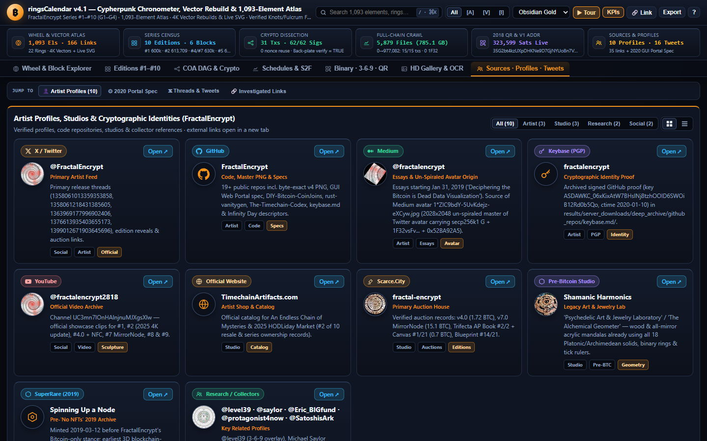</a> | [`05_sources_1440x900.jpg`](screenshots/05_sources_1440x900.jpg)<br/>`1440×900` · `Sources Tab` | `10` verified artist/studio/research profile cards (incl. Keybase PGP proof & Medium avatar origin), `16` threads & `35` links. |
| <a href="screenshots/06_theme_blueprint_1440x900.jpg">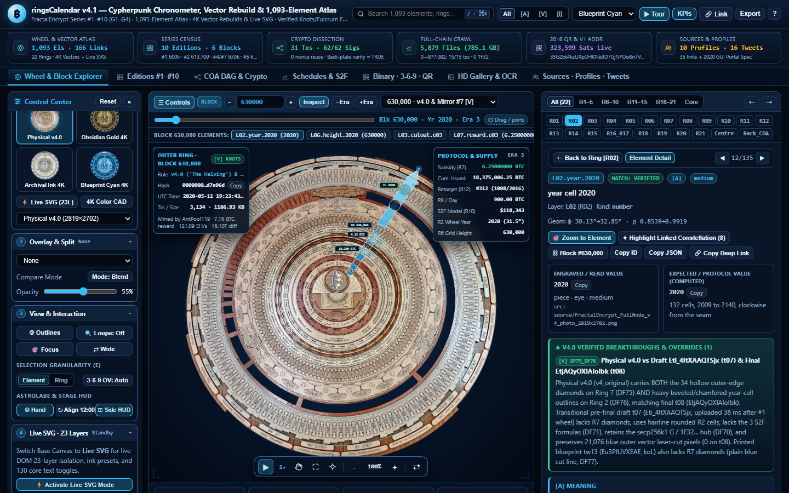</a> | [`06_theme_blueprint_1440x900.jpg`](screenshots/06_theme_blueprint_1440x900.jpg)<br/>`1440×900` · `Blueprint Cyan` | Drafting-table cyan studio theme on the wheel stage with cyan-tinted astrolabe hand & zero hardcoded orange leaks. |
| <a href="screenshots/07_theme_contrast_1440x900.jpg">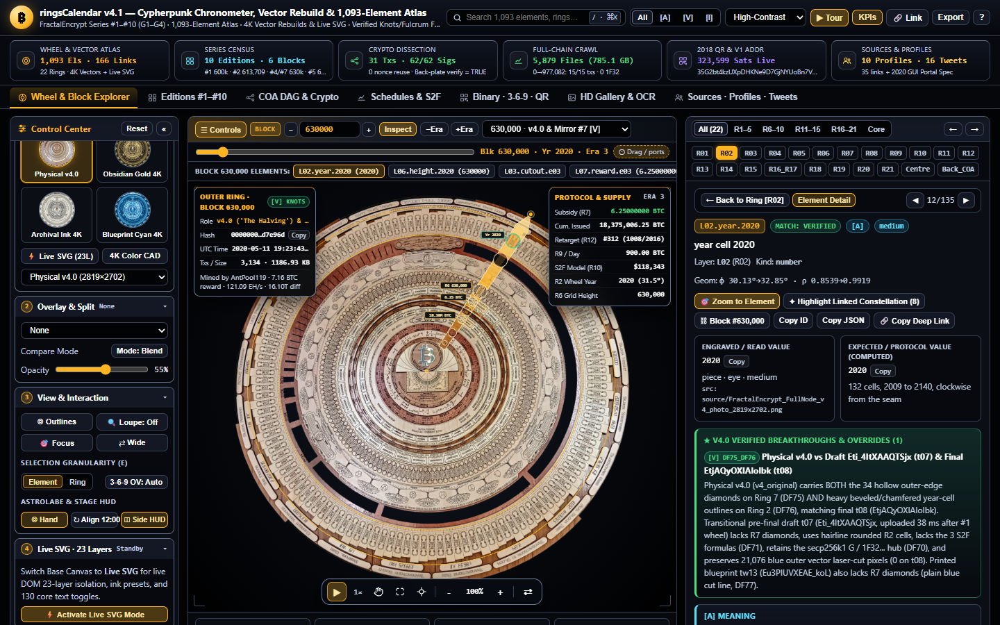</a> | [`07_theme_contrast_1440x900.jpg`](screenshots/07_theme_contrast_1440x900.jpg)<br/>`1440×900` · `High-Contrast` | High-legibility studio theme designed for reading dense hex strings, micro-engravings, and provenance filter cards. |
| <a href="screenshots/08_wheel_1280x800.jpg">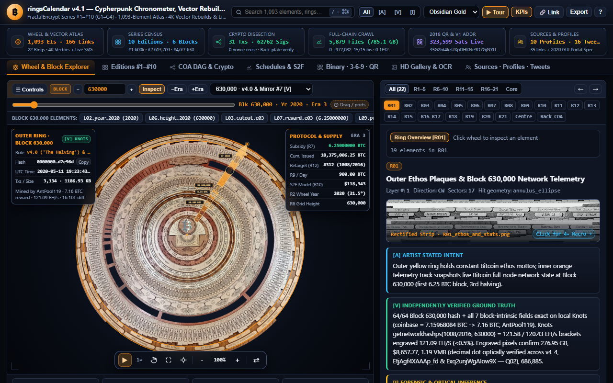</a> | [`08_wheel_1280x800.jpg`](screenshots/08_wheel_1280x800.jpg)<br/>`1280×800` · **Laptop** | Auto-collapsed Control Center slide-over drawer (<kbd>G</kbd> / `☰ Controls`) giving full vertical room to the wheel stage. |
| <a href="screenshots/09_wheel_768x1024.jpg">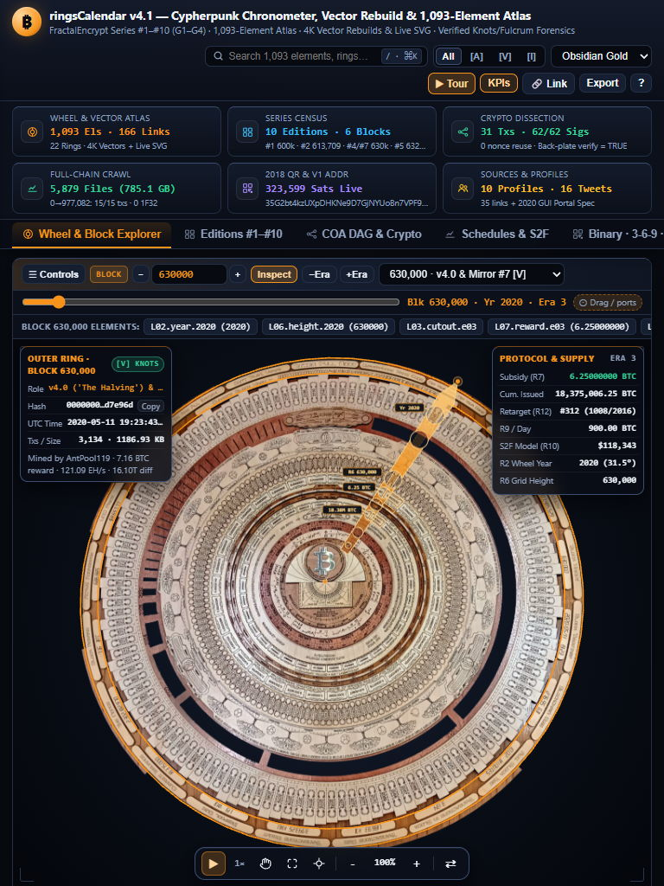</a> | [`09_wheel_768x1024.jpg`](screenshots/09_wheel_768x1024.jpg)<br/>`768×1024` · **Tablet** | Portrait tablet layout with two-finger touch focal pinch-to-zoom (`1×..8×`) and full wheel + dock above the fold. |
| <a href="screenshots/10_wheel_375x812.jpg">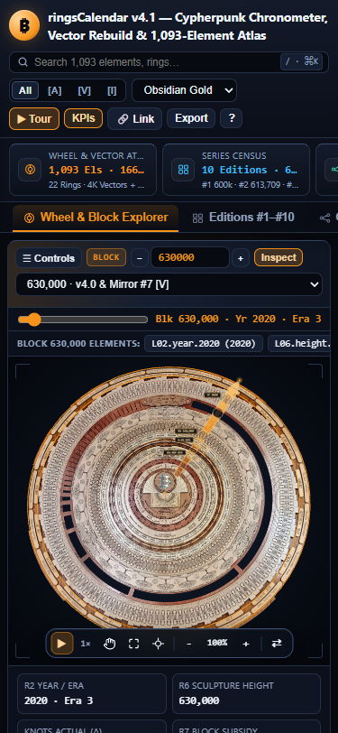</a> | [`10_wheel_375x812.jpg`](screenshots/10_wheel_375x812.jpg)<br/>`375×812` · **Mobile** | Compact mobile viewport featuring a single-row swipeable KPI strip and `0 px` horizontal overflow across all 7 tabs. |
| <a href="screenshots/11_portable_livesvg_fallback_1440x900.jpg">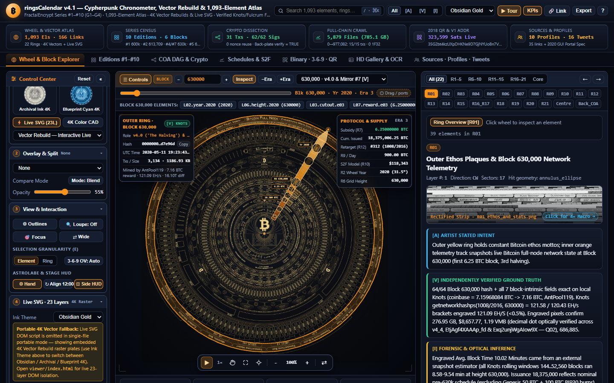</a> | [`11_portable_livesvg_fallback_1440x900.jpg`](screenshots/11_portable_livesvg_fallback_1440x900.jpg)<br/>`1440×900` · **Portable Vector** | Shows how `FractalE-Sculpture_blueprint-demo.html` seamlessly swaps embedded `Obsidian / Archival / Blueprint` vector plates offline. |
| <a href="screenshots/12_livesvg_split_overlay_1440x900.jpg"></a> | [`12_livesvg_split_overlay_1440x900.jpg`](screenshots/12_livesvg_split_overlay_1440x900.jpg)<br/>`1440×900` · **Split-Curtain** | Side-by-side `Split 55%` wipe comparing `4K 21-Layer Color CAD` against `Obsidian Gold` vector geometry. |
| <a href="screenshots/13_split_align12_1440x900.jpg"></a> | [`13_split_align12_1440x900.jpg`](screenshots/13_split_align12_1440x900.jpg)<br/>`1440×900` · **Align 12:00** | Counter-rotates the wheel (`-31.49°` at `Yr 2020`) so the clock hand meets `12:00` while `#split-divider` stays vertical. |
| <a href="screenshots/14_coa_blueprint_1440x900.jpg"></a> | [`14_coa_blueprint_1440x900.jpg`](screenshots/14_coa_blueprint_1440x900.jpg)<br/>`1440×900` · **COA UTXO DAG** | Complete CoinJoin lineage (`coa_v4` `32dab765...` through `10/10`, commissions, *Infinity Keys*, *Endless Chain* `1/9–4/9`). |
| <a href="screenshots/15_schedules_blueprint_1440x900.jpg">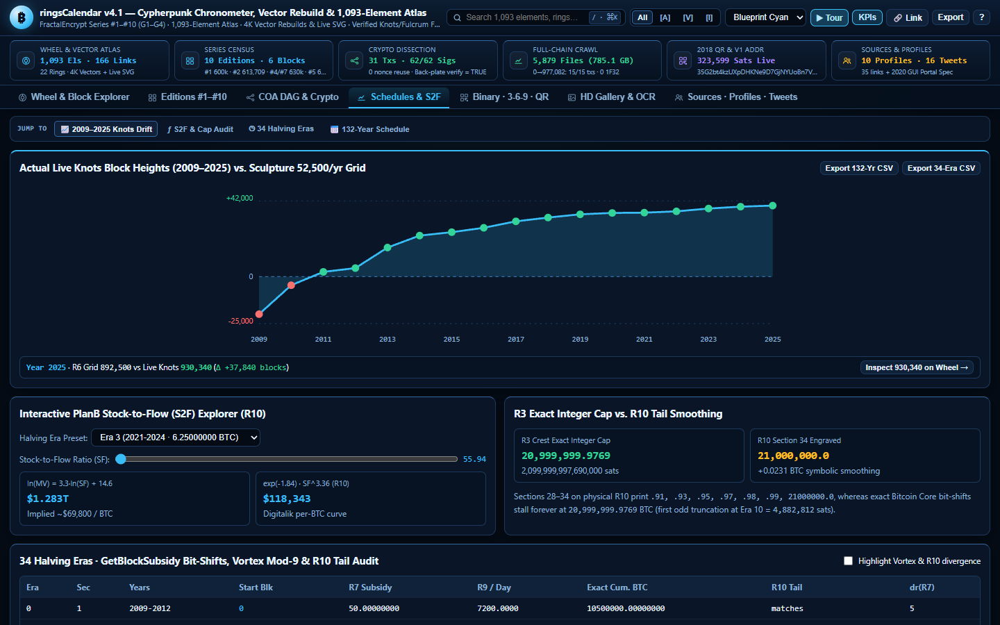</a> | [`15_schedules_blueprint_1440x900.jpg`](screenshots/15_schedules_blueprint_1440x900.jpg)<br/>`1440×900` · **Schedules & S2F** | Live Bitcoin Knots drift chart (`2025: +37,840` blocks), unclamped PlanB S2F calculator & `20,999,999.9769 BTC` cap audit. |
| <a href="screenshots/16_portable_compressed_footer_1440x900.jpg">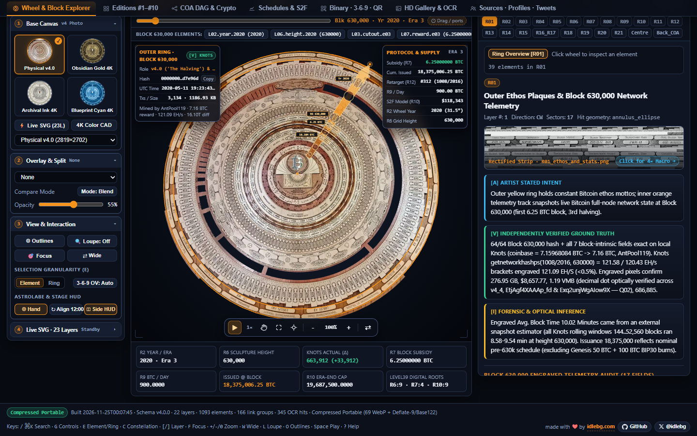</a> | [`16_portable_compressed_footer_1440x900.jpg`](screenshots/16_portable_compressed_footer_1440x900.jpg)<br/>`1440×900` · **Compressed Footer** | Symmetrical 8-cell (`4×2`) chronometer sync grid + `Compressed Portable` badge (`69 WebP + Deflate-9/Base122`) & studio links. |

---

## 6. Quick Start, Keyboard Shortcuts & Package Layout

### Run Online or 100% Offline

- **Online (Instant):** Open [**https://idlebg.com/FractalE-Sculpture_blueprint-demo.html**](https://idlebg.com/FractalE-Sculpture_blueprint-demo.html) in any modern browser.
- **Offline (`file:///`):** Download [`FractalE-Sculpture_blueprint-demo.html`](./FractalE-Sculpture_blueprint-demo.html) (`3.89 MiB`) and double-click it locally. Everything is self-contained inside that single file.

### Keyboard Shortcuts

| Key | Action | Key | Action |
|---|---|---|---|
| <kbd>/</kbd> or <kbd>Ctrl</kbd>+<kbd>K</kbd> | Global Search (`1,093` elements, blocks `0–6.93M`, OCR) | <kbd>F</kbd> | Auto-focus / toggle zoom on active Element or Ring |
| <kbd>G</kbd> | Toggle Left Control Center drawer | <kbd>W</kbd> | Toggle Wide Wheel Stage layout |
| <kbd>E</kbd> | Switch granularity (`Element` vs `Ring`) | <kbd>L</kbd> | Cycle Optical Magnifier Loupe (`Off → 3× → 5×`) |
| <kbd>C</kbd> | Toggle Cross-Ring Linked Constellation rays | <kbd>O</kbd> | Toggle 21-layer vector hitmap outlines |
| <kbd>[</kbd> / <kbd>]</kbd> | Previous / Next Ring Layer (`R01..Back_COA`) | <kbd>+</kbd> / <kbd>-</kbd> / <kbd>0</kbd> | Zoom In / Zoom Out / Reset `100%` |
| <kbd>Space</kbd> | Play / Pause 132-Year Bitcoin Chronometer | <kbd>?</kbd> / <kbd>Esc</kbd> | Open Help & Architecture Modal / Close modal |

### Repository Folder Structure

```text
production-demo/
├── FractalE-Sculpture_blueprint-demo.html   # Standalone v.0 offline HTML viewer (3.89 MiB / 4,084,087 B)
├── README.md                                # Interactive field guide, visual tour & v.0 disclaimers
└── screenshots/                             # Composite hero banner + 16 compressed progressive JPGs
    ├── 00_hero_banner.jpg
    ├── 01_wheel_1440x900.jpg
    ├── 02_element_inspector_1440x900.jpg
    ├── 03_live_svg_1440x900.jpg
    ├── 04_forensics_1440x900.jpg
    ├── 05_sources_1440x900.jpg
    ├── 06_theme_blueprint_1440x900.jpg
    ├── 07_theme_contrast_1440x900.jpg
    ├── 08_wheel_1280x800.jpg
    ├── 09_wheel_768x1024.jpg
    ├── 10_wheel_375x812.jpg
    ├── 11_portable_livesvg_fallback_1440x900.jpg
    ├── 12_livesvg_split_overlay_1440x900.jpg
    ├── 13_split_align12_1440x900.jpg
    ├── 14_coa_blueprint_1440x900.jpg
    ├── 15_schedules_blueprint_1440x900.jpg
    └── 16_portable_compressed_footer_1440x900.jpg
```

---

## 7. Legal Notice & `v.0` Non-Proof Disclaimer

> [!WARNING]
> **EXPERIMENTAL `v.0` RELEASE — NOT PROOF OF ANY KIND:**
>
> 1. **Version `v.0` Standalone Preview (Mistakes Expected):** `FractalE-Sculpture_blueprint-demo.html` and all accompanying text, tables, graphics, and hints in this repository constitute a **`v.0` pre-release standalone demonstration**. Software bugs, optical/OCR misreads, transcription errors, geometric/homography tolerances, incomplete records, and **mistakes of any kind are to be expected**.
> 2. **Not Proof of Any Kind:** Nothing in `FractalE-Sculpture_blueprint-demo.html` or this repository — including any dataset entry, visual overlay, cryptographic/signature check, block/edition attribution, schedule projection, or analytical note — is, or shall be considered, cited, or relied upon as, **proof of any kind** (whether proof of physical authenticity, provenance, chain of title, ownership, artist endorsement, valuation, legal fact, or financial/investment advice).
> 3. **Provided Strictly "AS IS":** Published solely for educational, artistic visualization, and independent cypherpunk research exploration **"AS IS" without warranties or representations of any kind**, express or implied. Always verify blockchain transactions, cryptographic signatures, and physical artwork provenance independently against primary sources.
> 4. **Artwork & Attribution:** The physical *Bitcoin Full Node Sculptures*, blueprints, and original 2020 portal concept belong to **FractalEncrypt / Timechain Artifacts** ([`FractalEncrypt/Bitcoin-Full-Node-GUI-Interactive-Web-Portal`](https://github.com/FractalEncrypt/Bitcoin-Full-Node-GUI-Interactive-Web-Portal)). This standalone interactive interface demonstration and research compilation were created independently by [**idlebg.com**](https://idlebg.com/) in collaboration with **Antigravity**, **Claude**, and **Codex**. Full source code will be released when we are ready.

---

<div align="center">
made with ❤ by <a href="https://idlebg.com/">idlebg.com</a>
</div>
